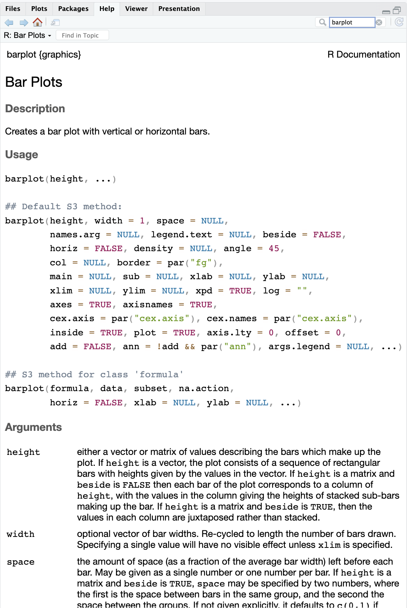

```{r, echo=FALSE, purl=FALSE, message = FALSE}
knitr::opts_chunk$set(results='hide', comment = "#>", purl = FALSE)
```

# Getting Started with R {#gettingstarted}

> Learning Objectives
>
> * Create R objects and and assign values to them.
> * Use comments to inform script.
> * Do simple arithmetic operations in R using values and objects.
> * Call functions with arguments and change their default options.
> * Inspect the content of vectors and manipulate their content.
> * Subset and extract values from vectors.
> * Correctly define and handle missing values in vectors.
> * Use the built-in RStudio help interface 
> * Interpret the R help documentation
> * Provide sufficient information for troubleshooting with the R user community.
> * Download, install, and load R packages.

------------


## Creating objects in R

To do useful and interesting things in R, we need to assign _values_ to
_objects_. To create an object^[What are known as `objects` in `R` are known as `variables` in many other programming languages.  Depending on the context, `object` and `variable` can
have drastically different meanings.  However, in this lesson, the two words are
used synonymously.  For more information see:
https://cran.r-project.org/doc/manuals/r-release/R-lang.html#Objects], we need to give it a name followed by the assignment operator `<-`, and the value we want to give it:

```{r, purl=FALSE}
 x <- 3
```

`<-` is the assignment operator. It assigns values on the right to objects on
the left. So, after executing ` x <- 3`, the value of `x` is `3`. The arrow can
be read as `3` **goes into** `x`.  You can also use `=`
for assignments, but not in every context. Because of
the
[slight](http://blog.revolutionanalytics.com/2008/12/use-equals-or-arrow-for-assignment.html) [differences](https://web.archive.org/web/20130610005305/https://stat.ethz.ch/pipermail/r-help/2009-March/191462.html) in
syntax, it is good practice to always use `<-` for assignments.

In RStudio, typing <kbd>Alt</kbd> + <kbd>-</kbd> (push <kbd>Alt</kbd> at the
same time as the <kbd>-</kbd> key) will write ` <- ` in a single keystroke.

Here are a few rules as of how to name objects in R.

- Objects can be given any name such as `x`, `current_temperature`, or
`subject_id`. 
- You want your object names to be explicit and not too long. 
- They **cannot** start with a number (`2x` is not valid, but `x2` is). 
- R is case sensitive
(e.g., `weight_kg` is different from `Weight_kg`). 
- There are some names that
cannot be used because they are the names of fundamental functions in R (e.g., `if`, `else`, `for`, see
[here](https://stat.ethz.ch/R-manual/R-devel/library/base/html/Reserved.html) for a complete list). In general, even if it is allowed, it's best to not use other function names (e.g., `c`, `T`, `mean`, `data`, `df`, `weights`). If in doubt, check the help to see if the name is already in use. 
- It's also best to
avoid dots (`.`) within a variable name as in `my.dataset`. There are many
functions in R with dots in their names for historical reasons, but because dots have a special meaning in R (for methods) and other programming languages, it is best to avoid them. 
- It is also recommended to use *nouns for variable names*, and
*verbs for function names*. 
- It's important to be consistent in the styling of your code (where you put spaces, how you name variables, etc.). Using a consistent
coding style makes your code clearer to read for your future self and your
collaborators.  
In R, three popular style guides
are
[Google's](https://google.github.io/styleguide/Rguide.xml),
[Jean Fan's](http://jef.works/R-style-guide/) and
the [tidyverse's](http://style.tidyverse.org/). The tidyverse's is very comprehensive
and may seem overwhelming at first. You can install the 
[**`lintr`**](https://github.com/jimhester/lintr) to automatically check for issues 
in the styling of your code.


When assigning a value to an object, R does not print anything. You can force R to print the value by using parentheses or by typing the object name:

```{r, purl=FALSE}
area_hectares <- 1.0    # doesn't print anything
area_hectares           # typing the name of the object prints the value of `area_hectares`
(area_hectares <- 1.0)  # and so does putting parenthesis around the call 
```

Now that R has `area_hectares` in memory, we can do arithmetic with it. For
instance, we may want to convert this area into acres (area in acres is 2.47 times the area in hectares):

```{r, purl=FALSE}
area_hectares  * 2.47
```

We can also change a variable's value by assigning it a new value:

```{r, purl=FALSE}
area_hectares <- 2.5
area_hectares * 2.47
```

This means that assigning a value to one variable does not change the values of
other variables.  For example, let's store the area in acres in a new
variable, `area_acres`:

```{r, purl=FALSE}
area_acres <- area_hectares * 2.47
```

and then change `area_hectares` to 50.

```{r, purl=FALSE}
area_hectares <- 50
```

> <h3>Challenge</h3>
> 
> What do you think is the current content of the object `area_acres`? 123.5 or 6.175?
>
>
>
> Create two variables `r_length` and `r_width` and assign them values. 
> 
> Calculate the area based on the current values of `r_length` and `r_width` and assign the result to a new, third variable `r_area`. 
>
> Demonstrate that changing the values of either `r_length` and `r_width` does not affect the value of `r_area`. Make ample use of comments in your code.

```{r, echo=FALSE, purl=TRUE}
## ANSWER
# r_length <- 2.5
# r_width <- 3.2
# r_area <- r_length * r_width
# r_area
# 
# # change the values of r_length and r_width
# r_length <- 7.0
# r_width <- 6.5
# # the value of r_area isn't changed
# r_area
```


## Functions and their arguments

Functions are "canned scripts" that automate a series of commands one might want to apply frequently. 

Many functions are predefined, or can be
made available by importing R *packages* (more on that later). A function
usually gets one or more inputs called *arguments*. Functions often (but not
always) return a *value*. 

An example would be the function `sqrt()`, which calculates the square root. The
input (=the *argument*) must be a number, and the return value (in fact, the
output) is the square root of that number. Executing a function ('running it') is called *calling* the function. An example of a function call is:

```{r, eval=FALSE, purl=FALSE}
sqrt(64)

# or provide the input to the function as a variable:
a <- 64
sqrt(a)

# we can also assign the output to a new variable:
b <- sqrt(a)
b
```

Here, we provide the number `64` as input to the `sqrt()` function, which
calculates the square root of the input value, and returns the result. We can also assign the value `64` to a variable  `a`, which is then given to the `sqrt()` function,we can also assign the output of the function to a variable, in this case a new variable `b`. 

The return 'value' of a function need not be numerical (like that of `sqrt()`),
and it also does not need to be a single item: it can be a set of things, or
even a dataset. We'll see that when we read data files into R.

Arguments can be anything, not only numbers or filenames, but also other
objects. Exactly what each argument means differs per function, and must be
looked up in the documentation (see below). Some functions take arguments which
may either be specified by the user, or, if left out, take on a *default* value:
these are called *options*. Options are typically used to alter the way the
function operates, such as whether it ignores 'bad values', or what symbol to
use in a plot.  However, if you want something specific, you can specify a value
of your choice which will be used instead of the default.

Let's try a function that can take multiple arguments: `round()`.

```{r, results='show', purl=FALSE}
round(3.14159)
```

Here, we've called `round()` with just one argument, `3.14159`, and it has
returned the value `3`.  That's because the default is to round to the nearest
whole number. If we want more digits we can see how to do that by getting
information about the `round` function.  

If we want a different number of digits, we can
type `digits=2` or however many we want.

```{r, results='show', purl=FALSE}
round(3.14159, digits = 2)
```

If you provide the arguments in the exact same order as they are defined you
don't have to name them:

```{r, results='show', purl=FALSE}
round(3.14159, 2)
```
And if you do name the arguments, you can switch their order:

```{r, results='show', purl=FALSE}
round(digits = 2, x = 3.14159)
```

Note:

- R evaluates function arguments in three steps: first, by _exact matching_ on argument name, then by _partial matching_ on argument name, and finally by _position_. 

- you _do not have to_ specify all of the arguments. If you don't, R will use default values if they are specified by the function. If no default value is specified, you will receive an error.

It's good practice to put the non-optional arguments (like the number you're
rounding) first in your function call, and to specify the names of all optional
arguments.  If you don't, someone reading your code might have to look up the
definition of a function with unfamiliar arguments to understand what you're
doing.

Functions usually return someting back to you as output. Whatever they return (a table, some informational text, a logical value, ...) is by default written to the console, so you can see it right away.

Oftentimes, however, we want re-use the output of such a function. That is when you assign the output to an R object to be accessed later on.


## Seeking help

So, how do we know how to use a particular function and which arguments it takes?

There are a number of approaches to be aware of.

One of the most immediate ways to get help, is to use the RStudio help interface (Figure \@ref(fig:use-help)). In the default configuration this panel by default can be found at the lower right hand panel of RStudio. You can search for the function using the search box on the top right. As you are typing, RStudio tries to also give a number of suggestions that you might be interested in. The description is then shown in the display window.

```{r use-help, echo=FALSE, results='asis', out.width='80%', fig.cap='Example of R help page'}

```

We can also look at the help for a function using the question mark in front of the name of the function. If you run this command it will launch the same RStudio help window as above.

```{r, eval=FALSE, purl=FALSE}
?barplot
```

We can just look at the arguments using the `arg` function, like so:

```{r, results='show', purl=FALSE}
args(lm)
```

If you are looking for a function to do a particular task, you can use the
`help.search()` function, which is called by the double question mark `??`.
This command looks through the installed packages for help pages with a
match to your search request and suggests some links to possible help pages in the 
RSTudio help pane.

```{r, eval=FALSE, purl=FALSE}
??kruskal
```

Lastly, Google and [Stack Overflow](http://stackoverflow.com/questions/tagged/r) are good places to search for solutions to error messages.

### Generative AI Help

In addition to the resources we've already mentioned for getting help with R, it's becoming increasingly common to turn to _generative AI_ chatbots such as ChatGPT to get help while coding. You will probably receive some useful guidance by presenting your error message to the chatbot and asking it what went wrong.

However, the way this help is provided by the chatbot is different. Answers on Stack Overflow have (probably) been given by a human as a direct response to the question asked. But generative AI chatbots, which are based on an advanced statistical model, respond by generating the _most likely_ sequence of text that would follow the prompt they are given.

While responses from generative AI tools can often be helpful, they are not always reliable. 
These tools sometimes generate plausible but incorrect or misleading information, so (just as with an answer found on the internet) it is essential to verify their accuracy.
You need the knowledge and skills to be able to understand these responses, to judge whether or not they are accurate, and to fix any errors in the code it offers you.

In addition to asking for help, programmers can use generative AI tools to generate code from scratch; extend, improve and reorganise existing code; translate code between programming languages; figure out what terms to use in a search of the internet; and more.
However, there are drawbacks that you should be aware of.

The models used by these tools have been "trained" on very large volumes of data, much of it taken from the internet, and the responses they produce reflect that training data, and may recapitulate its inaccuracies or biases.
The environmental costs (energy and water use) of LLMs are a lot higher than other technologies, both during development (known as training) and when an individual user uses one (also called inference). For more information see the [AI Environmental Impact Primer](https://huggingface.co/blog/sasha/ai-environment-primer) developed by researchers at HuggingFace, an AI hosting platform. 
Concerns also exist about the way the data for this training was obtained, with questions raised about whether the people developing the LLMs had permission to use it.
Other ethical concerns have also been raised, such as reports that workers were exploited during the training process.

**We recommend that you avoid getting help from generative AI during the workshop** for several reasons:

1. For most problems you will encounter at this stage, help and answers can be found among the first results returned by searching the internet.
2. The foundational knowledge and skills you will learn in this lesson by writing and fixing your own programs  are essential to be able to evaluate the correctness and safety of any code you receive from online help or a generative AI chatbot. 
   If you choose to use these tools in the future, the expertise you gain from learning and practising these fundamentals on your own will help you use them more effectively.
3. As you start out with programming, the mistakes you make will be the kinds that have also been made -- and overcome! -- by everybody else who learned to program before you. 
  Since these mistakes and the questions you are likely to have at this stage are common, they are also better represented than other, more specialised problems and tasks in the data that was used to train generative AI tools.
  This means that a generative AI chatbot is _more likely to produce accurate responses_ to questions that novices ask, which could give you a false impression of how reliable they will be when you are ready to do things that are more advanced.

> <h3>Challenge</h3>
> 
> Investigate the help of the `mean()` function    
> - what does the function do?    
> - how do you use it?    
> - what are the arguments? which ones are required, which ones are optional?    
> - what does the function return?    
> - try to run the code example provided


### How to ask for help

The key to receiving help from someone is for them to rapidly grasp your
problem. You should make it as easy as possible to pinpoint where the issue
might be.

Try to use the correct words to describe your problem. For instance, a package
is not the same thing as a library. Most people will understand what you meant,
but others have really strong feelings about the difference in meaning. The key
point is that it can make things confusing for people trying to help you. Be as
precise as possible when describing your problem.

If possible, try to reduce what doesn't work to a simple *reproducible
example*. If you can reproduce the problem using a very small data frame
instead of your 50,000 rows and 10,000 columns one, provide the small one with
the description of your problem. When appropriate, try to generalize what you
are doing so even people who are not in your field can understand the
question. For instance instead of using a subset of your real dataset, create a
small (3 columns, 5 rows) generic one. For more information on how to write a
reproducible example see [this article by Hadley Wickham](http://adv-r.had.co.nz/Reproducibility.html).

To share an object with someone else, if it's relatively small, you can use the
function `dput()`. It will output R code that can be used to recreate the exact
same object as the one in memory:

```{r, results='show', purl=FALSE}
# iris is an example data frame that comes with R and 
# head() is a function that returns the first part of the data frame
dput(head(iris)) 
```

If the object is larger, provide either the raw file (i.e., your CSV file) with
your script up to the point of the error (and after removing everything that is
not relevant to your issue). Alternatively, in particular if your question is
not related to a data frame, you can save any R object to a file:

```{r, eval=FALSE, purl=FALSE}
saveRDS(iris, file="/tmp/iris.rds")
```

The content of this file is however not human readable and cannot be posted
directly on Stack Overflow. Instead, it can be sent to someone by email who can
read it with the `readRDS()` command (here it is assumed that the downloaded
file is in a `Downloads` folder in the user's home directory):

```{r, eval=FALSE, purl=FALSE}
some_data <- readRDS(file="~/Downloads/iris.rds")
```

Last, but certainly not least, **always include the output of `sessionInfo()`**
as it provides critical information about your platform, the versions of R and
the packages that you are using, and other information that can be very helpful
to understand your problem.

```{r, results='show', purl=FALSE}
sessionInfo()
```

### Where to ask for help?

* The person sitting next to you during the workshop. Don't hesitate to talk to
  your neighbor during the workshop, compare your answers, and ask for
  help. You might also be interested in organizing regular meetings following
  the workshop to keep learning from each other.
* Your friendly colleagues: if you know someone with more experience than you,
  they might be able and willing to help you.
* [Stack Overflow](http://stackoverflow.com/questions/tagged/r): if your question
  hasn't been answered before and is well crafted, chances are you will get an
  answer in less than 5 min. Remember to follow their guidelines on [how to ask
  a good question](http://stackoverflow.com/help/how-to-ask).
* The [R-help mailing list](https://stat.ethz.ch/mailman/listinfo/r-help): it is
  read by a lot of people (including most of the R core team), a lot of people
  post to it, but the tone can be pretty dry, and it is not always very
  welcoming to new users. If your question is valid, you are likely to get an
  answer very fast but don't expect that it will come with smiley faces. Also,
  here more than anywhere else, be sure to use correct vocabulary (otherwise
  you might get an answer pointing to the misuse of your words rather than
  answering your question). You will also have more success if your question is
  about a base function rather than a specific package.
* If your question is about a specific package, see if there is a mailing list
  for it. Usually it's included in the DESCRIPTION file of the package that can
  be accessed using `packageDescription("name-of-package")`. You may also want
  to try to email the author of the package directly, or open an issue on the
  code repository (e.g., GitHub).
* There are also some topic-specific mailing lists (GIS, phylogenetics, etc...),
  the complete list is [here](http://www.r-project.org/mail.html).

### Resources on getting help

* The [Posting Guide](http://www.r-project.org/posting-guide.html) for the R
  mailing lists.
* [How to ask for R help](http://blog.revolutionanalytics.com/2014/01/how-to-ask-for-r-help.html)
  useful guidelines
* [Writing the perfect question by Jon Skeet](http://codeblog.jonskeet.uk/2010/08/29/writing-the-perfect-question/)
* The [reprex](https://cran.rstudio.com/web/packages/reprex/) package to create reproducible examples when asking for help. The [rOpenSci community call "How to ask questions so they get answered"], [Github link](https://github.com/ropensci/commcalls/issues/14) and [video recording](https://vimeo.com/208749032) includes a presentation of the reprex package and of its philosophy.
 

## Vectors and data types

```{r, echo=FALSE, purl=TRUE}
### Vectors and data types
```

A vector is the most common and basic data type in R, and is pretty much
the workhorse of R. A vector is composed by a series of values, which can be
either numbers or characters. We can assign a series of values to a vector using
the `c()` function. For example we can create a vector of weights and assign
it to a new object `area_hectares`:

```{r, results='show', purl=FALSE}
area_hectares <- c(21, 34, 39, 54, 55)
area_hectares
```

There are many functions that allow you to inspect the content of a
vector. `length()` tells you how many elements are in a particular vector:

```{r, results='show', purl=FALSE}
length(area_hectares)
```

An important feature of a vector, is that all of the elements are the same type of data.
The function `class()` indicates the class (the type of element) of an object:

```{r, results='show', purl=FALSE}
class(area_hectares)
```

The function `str()` provides an overview of the structure of an object and its
elements. It is a useful function when working with large and complex
objects:

```{r, results='show', purl=FALSE}
str(area_hectares)
```

You can use the `c()` function to add other elements to your vector:
```{r, results='show', purl=FALSE}
area_hectares <- c(area_hectares, 90) # add to the end of the vector
area_hectares <- c(30, area_hectares) # add to the beginning of the vector
area_hectares
```

In the first line, we take the original vector `area_hectares`,
add the value `90` to the end of it, and save the result back into
`area_hectares`. Then we add the value `30` to the beginning, again saving the result back into `area_hectares`.

We can do this over and over again to grow a vector, or assemble a dataset.
As we program, this may be useful to add results that we are collecting or
calculating.

A vector can also contain characters:

```{r, results='show', purl=FALSE}
animals <- c("mouse", "rat", "dog", "octopus")
class(animals)
```

The quotes around "mouse", "rat", etc. are essential here. Without the quotes R
will assume there are objects called `mouse`, `rat` and `dog`. As these objects
don't exist in R's memory, there will be an error message.

Lastly, we will introduce a vector with logical values (the boolean data type).

```{r, results='show', purl=FALSE}
has_tail <- c(TRUE, TRUE, TRUE, FALSE)
has_tail 
class(has_tail)
```

We just saw 3 of the 6 main **atomic vector** types (or **data types**) that R
uses: `"character"`,  `"numeric"` and `"logical"`. These are the basic building blocks that all R objects are built from. The other 3 are:

* `"integer"` for integer numbers (e.g., `2L`, the `L` indicates to R that it's an integer)
* `"complex"` to represent complex numbers with real and imaginary parts (e.g.,
  `1 + 4i`) and that's all we're going to say about them
* `"raw"` that we won't discuss further


> <h3>Challenge</h3>
>
> * We’ve seen that atomic vectors can be of type character,
>   numeric, integer, and logical. But what happens if we try to mix these types in
>   a single vector?
> 
> <!-- * _Answer_: R implicitly converts them to all be the same type -->
>
> * What will happen in each of these examples? (hint: use `class()`
>   to check the data type of your objects):
>
>     ```r
>     num_char <- c(1, 2, 3, 'a')
>     num_logical <- c(1, 2, 3, TRUE)
>     char_logical <- c('a', 'b', 'c', TRUE)
>     tricky <- c(1, 2, 3, '4')
>     ```
>
> * Why do you think it happens?
> <!-- * _Answer_: Vectors can be of only one data type. R tries to convert (coerce)
>   the content of this vector to find a "common denominator". -->
>
> * You've probably noticed that objects of different types get
>   converted into a single, shared type within a vector. In R, we
>   call converting objects from one class into another class
>   _coercion_. These conversions happen according to a hierarchy,
>   whereby some types get preferentially coerced into other
>   types. Can you draw a diagram that represents the hierarchy of how
>   these data types are coerced?
> <!-- * _Answer_: `logical -> numeric -> character <-- logical` -->

```{r, echo=FALSE, eval=FALSE, purl=TRUE}
## We’ve seen that atomic vectors can be of type character, numeric, integer, and
## logical. But what happens if we try to mix these types in a single
## vector?

## What will happen in each of these examples? (hint: use `class()` to
## check the data type of your object)
num_char <- c(1, 2, 3, "a")

num_logical <- c(1, 2, 3, TRUE)

char_logical <- c("a", "b", "c", TRUE)

tricky <- c(1, 2, 3, "4")

## Why do you think it happens?

## You've probably noticed that objects of different types get
## converted into a single, shared type within a vector. In R, we call
## converting objects from one class into another class
## _coercion_. These conversions happen according to a hierarchy,
## whereby some types get preferentially coerced into other types. Can
## you draw a diagram that represents the hierarchy of how these data
## types are coerced?
```

## Subsetting vectors

Subsetting (sometimes referred to as extracting or indexing) involves accessing out one or more values based on their numeric placement or “index” within a vector. If we want to extract one or several values from a vector, we must provide one
or several indices in square brackets. For instance:

```{r, results='show', purl=FALSE}
animals[2]
animals[c(3, 2)]
```

We can use the colon `:` to select a sequence of indices. `:` is a special function that creates numeric vectors of integers in increasing or decreasing order, for instance `1:10` or `10:1` for instance. We can take advantage of it like this: 

```{r, results='show', purl=FALSE}
animals[2:4]
```

You can exclude elements of a vector using the "`-`" sign:
```{r, results='show', purl=FALSE}
animals[-2]
animals[-c(1:3)]
```

We can also repeat the indices to create an object with more elements than the
original one:

```{r, results='show', purl=FALSE}
more_animals <- animals[c(1, 2, 3, 2, 1, 4)]
more_animals
```

It is important to know that **R indices start at 1**. Programming languages like MATLAB, 
Julia, and R start counting at 1, because that's what human beings typically do. Languages in the C family (including C++, Java, Perl, and Python) count from 0 because that's
simpler for computers to do.

### Conditional subsetting

Another common way of subsetting is by using a logical vector. `TRUE` will
select the element with the same index, while `FALSE` will not.

```{r, results='show', purl=FALSE}
has_tail # this is a logical vector
animals[has_tail] # we use it here in the [ ] to subset
```

Typically, however, these logical vectors are not typed out by hand like we just did, but they are created as output of functions or of logical tests. 

We use the following operators for this:

* **relational operators** - return logical values indicating where a relation is satisfied. The most commonly used logical operators for data analysis are as follows:   
`==` means "equal to"^[The double equal sign `==` is a test for numerical equality between the left and right hand sides, and should not be confused with the single `=` sign, which performs variable assignment (similar
to `<-`).]         
`!=` means "not equal to"       
`>` or `<` means "greater than" or "less than"       
`>=` or `<=` means "greater than or equal to" or "less than or equal to"

* **logical operators** – join subset criteria together     
`&` means “and” – where two criterium must both be satisfied     
`|` means “or” – where at least one criterium must be satisfied

* **the "inclusion operator"** `%in%` – allows you to test if any of the elements of a search vector (on the left hand side) are found in the target vector (on the right hand side).

For example, we can search for certain strings in a vector. One could use the
"or" operator `|` to test for equality to multiple values like so:

```{r, results='show', purl=FALSE}
animals[animals == "frog" | animals == "rat"] 
```

But this can quickly become tedious if you have more strings that you want to search for. The function `%in%` allows you to test if any of the elements of a search vector are found:
```{r, results='show', purl=FALSE}
animals %in% c("dog", "rat") # this creates the logical vector
animals[animals %in% c("dog", "rat")] # we use it here in the [ ] to subset

# The same, but here is how I would typically do it:
animals_to_find <- c("dog", "rat") # create a vector with the values you are looking for
animals[animals %in% animals_to_find] # apply it in the condition here
```


Equivalently, if you wanted to select only the areas above 50:

```{r, results='show', purl=FALSE}
area_hectares > 50    # will return logicals with TRUE for the indices that meet the condition
## so we can use this to select only the values above 50
area_hectares[area_hectares > 50]
```

You can combine multiple tests using `&` (both conditions are true, AND) or `|`
(at least one of the conditions is true, OR):

```{r, results='show', purl=FALSE}
area_hectares[area_hectares > 50 & area_hectares < 90]
```


> <h3>Challenge</h3>
>
> Make sure your `area_hectares` vector contains the following values: 30, 21, 34, 39, 54, 55, 90, if not recreate it.   
>   
> * subset `area_hectares` to only the values equal or less than 30
> * subset `area_hectares` to only the values 39 and 90
> * subset `area_hectares` to only the values greater than 30 and less than 50 

> Use the animals vectors to:
> * subset `animals` to only contain 'dog' 
> * subset `more-animals` to contain 'mouse' and 'rat'
>     
> * What does `"four" > "five"` return and why?

```{r, echo=FALSE, purl=TRUE}
### Challenge
## * 
## * What does `"four" > "five"` return and why?

### Explain why this needs to be OR
## > * subset `area_hectares` to only the values greater than 30 and less than 50 
####      area_hectares[area_hectares < 30 | area_hectares > 50]

```

<!--
```{r, purl=FALSE}
## Answers
## * When using ">" or "<" on strings, R compares their alphabetical order. 
## Alphabetically the "o" in four comes after the "i" in five and therefore is "greater than".
```
-->


## Vectorization

Most of R’s functions are vectorized, meaning that the function will operate on **all** elements of a vector without needing to loop through and act on each element one at a time. This makes writing code more concise, easy to read, and less error prone.

```{r, results='show'}
x <- 1:4
x * 2
```

The multiplication happened to each element of the vector.

We can also add two vectors together:
```{r, results='show'}
y <- 6:9
x + y
```

Each element of `x` was added to its corresponding element of `y`:

```{r, eval=FALSE}
x:  1  2  3  4
    +  +  +  +
y:  6  7  8  9
---------------
    7  9 11 13
```


> <h3>Challenge</h3>
> Convert the `area_hectars` vector into acres

Comparison operators, logical operators, and many functions are also
vectorized:

**Comparison operators**

```{r, results='show'}
x > 2
```

**Logical operators**

```{r, results='show'}
a <- x > 3  # or, for clarity, a <- (x > 3)
a
```

Most functions also operate element-wise on vectors:

**Functions**

```{r, results='show'}
x <- 1:4
log(x)
```

### Operations on vectors of unequal length

Operations can also be performed on vectors of unequal length, through
a process known as *recycling*. This process automatically repeats the smaller vector
until it matches the length of the larger vector. R will provide a warning
(only!) if the larger vector is not a multiple of the smaller vector.

```{r, results='show'}
x <- c(1, 2, 3)
y <- c(1, 2, 3, 4, 5, 6, 7)
x + y
```

Vector `x` was recycled to match the length of vector `y`

```{r, eval=FALSE}
x:  1  2  3  1  2  3  1
    +  +  +  +  +  +  +
y:  1  2  3  4  5  6  7
-----------------------
    2  4  6  5  7  9  8
```


## Missing data

As R was designed to analyze datasets, it includes the concept of missing data
(which is uncommon in other programming languages). Missing data are represented
in vectors as `NA`.

When doing operations on numbers, most functions will return `NA` if the data
you are working with include missing values. This feature
makes it harder to overlook the cases where you are dealing with missing data.
You may remember from earlier that you can add an argument `na.rm=TRUE` to the `mean()` function to calculate the result while ignoring the missing values. The same applies for some other function, like `sum()`:

```{r, results='show', purl=FALSE}
age <- c(2, 4, 4, NA, 6, NA, 3)
mean(age)
sum(age)
mean(age, na.rm = TRUE)
sum(age, na.rm = TRUE)
```

If your data include missing values, you may want to become familiar with the
functions `is.na()`, `na.omit()`, and `complete.cases()`. See below for
examples.


```{r, results='show', purl=FALSE}
# Extract elements which are not missing values.
## The ! character is also called the NOT operator
age[!is.na(age)]

# Returns the object with incomplete cases removed. The returned object is atomic.
na.omit(age)

## Count the number of missing values.
## The output of is.na() is a logical vector (TRUE/FALSE equivalent to 1/0) so the sum() function here is effectively counting
sum(is.na(age))

# Extract elements which are complete cases.
complete.cases(age) # this is a logical vector
age[complete.cases(age)]
```

> <h3>Challenge</h3>
>
> 1. Using this vector `pop` with population counts and create a new vector with the NAs
> removed.
>
>     ```r
>     pop <- c(10,24,NA,18,NA,20)
>     ```
>
> 2. Use the function `sum()` to calculate the total of the `pop`.
> 
> 3. Use code to determine how many NAs are in `pop`
>
> 4. How many of the population counts are of size 15 and over?

```{r,echo=FALSE, purl=TRUE}
## Challenge
## 1. Using this vector of pop counts, create a new vector with the NAs
## removed.
##
##    pop <- c(10,24,NA,18,NA,20)
##    
##    pop[!is.na(pop)]
##
## 2. Use the function `sum()` to calculate the total of the `population`.
##    sum(pop, na.rm=T)
## 3. How many NAs   
##    sum(is.na(pop))
## 4. How many of the populations are of size 15 and over?   
##    sum(pop > 15, na.rm = T)
```


## Common R Data Structures

Vectors are one of the many **data structures** that R uses. Other important
ones are matrices (`matrix`), tables (`data.frame`), lists (`list`), and
factors (`factor`).

### Matrix
If we arrange data elements of a vector in a two-dimensional rectangular layout we have a matrix. To construct a matrix, we use a function conveniently called `matrix()`.

```{r eval=FALSE}
y <- matrix(1:20, nrow=5,ncol=4) # generates 5 x 4 numeric matrix
```

Subset a matrix with [row `,` column]:

```{r eval=FALSE}
y[,4]       # 4th column of matrix
y[3,]       # 3rd row of matrix
y[2:4,1:3]  # rows 2,3,4 of columns 1,2,3
```


### List
Lists can have elements of any type. Here is how we construct lists. You may have guessed that to construct a list, we use the `list()` function:

```{r eval=FALSE}
myl <- list(id="ID_1", a_vector=animals, a_matrix=y, age=5.3) # example of a list with 4 components
myl[[2]] # 2nd component of the list
myl[["id"]] # component named id in list
```

### Data frame

Data frames in R are a special case of lists, as they can have elements of any type, but they have to **all be of the same length**.

A data frame is the most common way of storing tabular data in R and something you will likely deal with a lot. As a first approximation, which holds true, probably in the most cases, you can really think of it as a table or a spreadsheet.  

Here is how you could construct a data frame.
```{r}
mydf <- data.frame(ID=c(1:4),
                   Color=c("red", "white", "red", NA),
                   Passed=c(TRUE,TRUE,TRUE,FALSE),
                   Weight=c(99, 54, 85, 70),
                   Height=c(1.78, 1.67, 1.82, 1.59))

mydf
```

We will go into more detail about data frames. For now, try the following:

> <h3>Challenge</h3>
>
> 1. Create a data frame that holds the following information for yourself, 
> your right and your left neighbor:
>
> - first name
> - last name
> - lucky number
>
> 2. There are
>   a few mistakes in this hand-crafted `data.frame`, can you spot and fix them?
>   Don't hesitate to experiment!
>
>     ```{r, eval=FALSE, purl=FALSE}
>     animal_data <- data.frame(animal=c("dog", "cat", "sea cucumber", "sea urchin),
>                               feel=c("furry", "squishy", "spiny"),
>                               weight=c(45, 8 1.1, 0.8))
>     ```
>
```{r, eval=FALSE, purl=TRUE, echo=FALSE}
## Challenge:
##  There are a few mistakes in this hand-crafted `data.frame`,
##  can you spot and fix them? Don't hesitate to experiment!
     animal_data <- data.frame(animal=c("dog", "cat", "sea cucumber", "sea urchin),
                               feel=c("furry", "squishy", "spiny"),
                               weight=c(45, 8 1.1, 0.8))
```

<!--- Answers
```{r, eval=FALSE, echo=FALSE, purl=FALSE}
## Answers
## * missing quotations around the names of the animals
## * missing one entry in the "feel" column (probably for one of the furry animals)
## * missing one comma in the weight column
```
-->


## Extending R base functionality

R comes with a base system and some contributed core packages. This is what you just downloaded. The functionality of R can be significantly extended by using additional contributed packages. Those packages typically contain commands (functions) for more specialized tasks. They can also contain example datasets. We will make use of external packages later.


### Installing additional packages

To install additional packages there are two main options:

1. You can use the RStudio interface like this:

```{r install-packages, echo=FALSE, results='asis', out.width='40%', fig.show='hold', fig.cap='How to install an R package with the RStudio interface'}
knitr::include_graphics(c('img/installpckg1.png', 'img/installpckg2.png'))
```


2. You can install from the R console like this:

```{r eval=FALSE}
# to install a package called "tidyverse", for example: (more on this later)
install.packages("tidyverse", dependencies = TRUE)
```

(We will talk about the `tidyverse` package collection shortly.)

### Make use of the installed packages

In order to actually use commands from the installed packages you also will need to load the installed packages. This can be automated (whenever you launch R it will also load the libraries for you - see for example [here](http://stackoverflow.com/a/14238658/2630957)) or otherwise you need to sumbit a command:

```{r eval=FALSE}
library(tidyverse)
```
or
```{r eval=FALSE}
require(tidyverse)
```

The difference between the two is that `library` will result in an error, if the library does not exist, whereas `require` will result in a warning.

> <h3>Challenge</h3>
>
> 1. Google for an R package that might be of interest for your research.
> 2. Install and load it into R.
